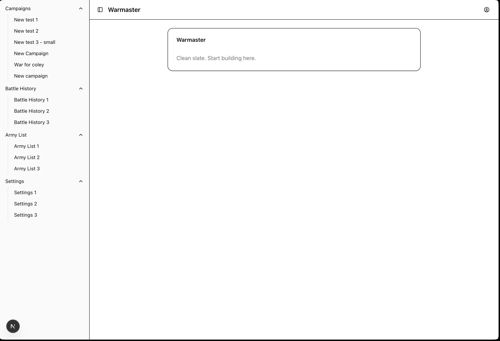
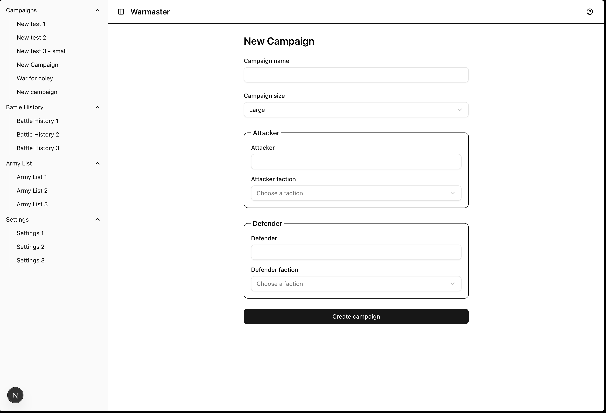
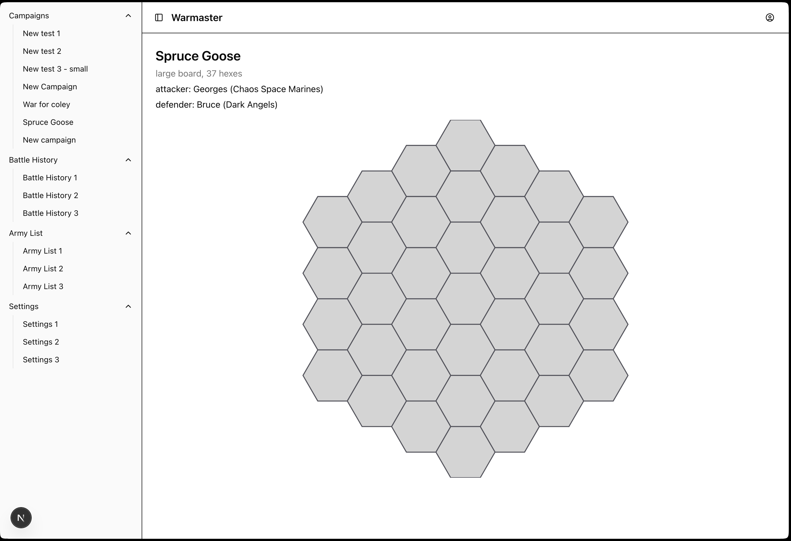
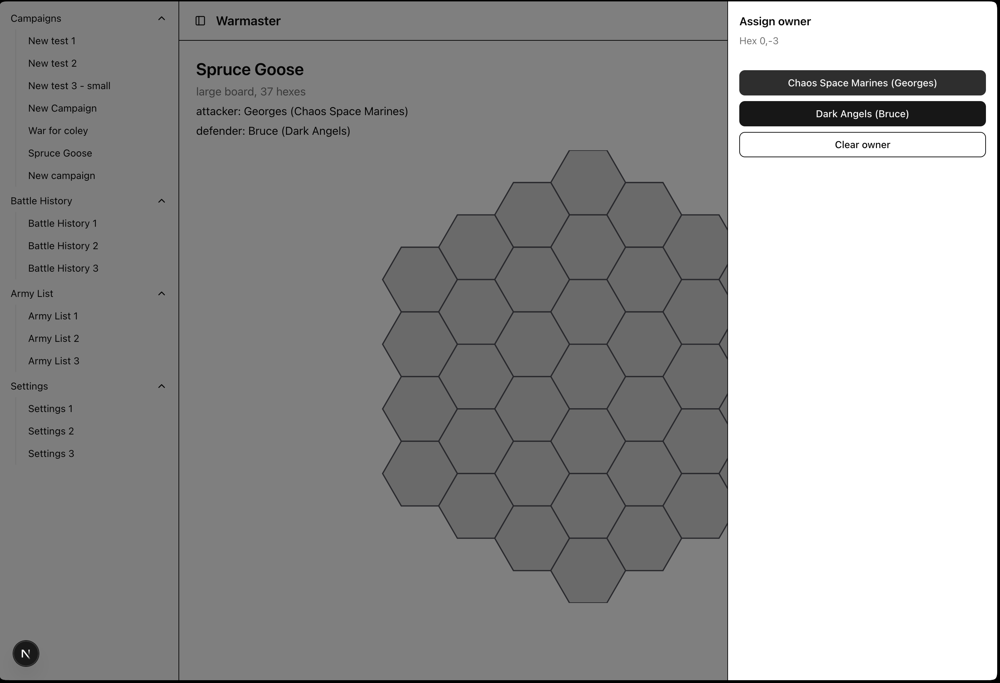
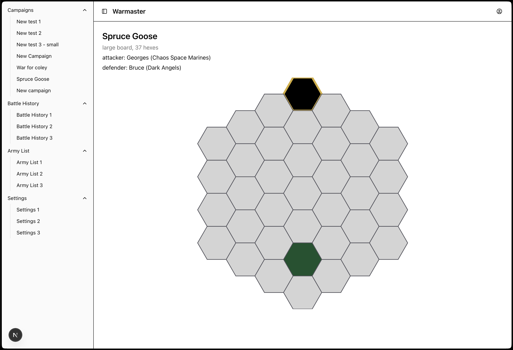

# Overseer

Overseer is a web app for running Warhammer 40k campaigns. Create a campaign, pick a board size, name the attacker and defender with a faction each, then assign hexes on the map. Each hex is drawn in its owner's faction colours and can be reassigned after every battle.

## Setup

The SQLite database is not stored in git, so create it after cloning:

```bash
npm install
cp apps/web/.env.example apps/web/.env
cd apps/web
npx prisma migrate deploy   # creates dev.db and applies the migrations
npx prisma generate         # generates the Prisma client
cd ../..
npm run dev
```

Open [http://localhost:3000](http://localhost:3000).

`apps/web/.env` holds `DATABASE_URL="file:./dev.db"`, a path relative to `apps/web`. Use `prisma migrate deploy` to apply existing migrations. Only use `prisma migrate dev` when you are changing `prisma/schema.prisma`.

To start again with an empty database, delete `apps/web/dev.db` and run `npx prisma migrate deploy` again.

## Commands

Run these from the repo root.

| Command             | What it does                                                       |
| ------------------- | ------------------------------------------------------------------ |
| `npm run dev`       | Start the dev server                                               |
| `npm run build`     | Production build                                                   |
| `npm run start`     | Serve the production build                                         |
| `npm run lint`      | ESLint. Warnings count as failures                                 |
| `npm run typecheck` | TypeScript check with no output files                              |
| `npm run test`      | Jest and React Testing Library                                     |
| `npm run verify`    | Typecheck, lint, test and build. Must pass before work is finished |
| `npm run format`    | Prettier on the whole repo                                         |

Git commits run `lint-staged` through Husky, which formats staged files with Prettier.

## Stack and structure

- Next.js (App Router), React, TypeScript, ShadCN UI (`packages/ui`)
- Prisma with SQLite
- Jest and React Testing Library
- Feature-Sliced Design under `apps/web/src`: `app`, `widgets`, `features`, `entities`, `shared`. Slices expose a public `index.ts`, and imports only go downward. See `AGENTS.md` for the full rules.

## Assumptions

- Players are names only. There are no accounts yet, so anyone with a campaign link can change its board. The campaign page says so.
- The sidebar lists every campaign. Filtering by membership needs user accounts.
- Hexes can be reassigned at any time. There is no lock after a campaign starts.

## Agent tooling

`.opencode/` configures AI agents for this repo: `peon` (mechanical edits), `tester` (tests), `reviewer` (read-only review), a `/ship` command (verify, review, commit) and skills for FSD review and Prettier-on-commit. Agents follow `AGENTS.md`, never bypass git hooks, and do not finish a task until `npm run verify` passes.

## Screenshots - New Campaign flow






